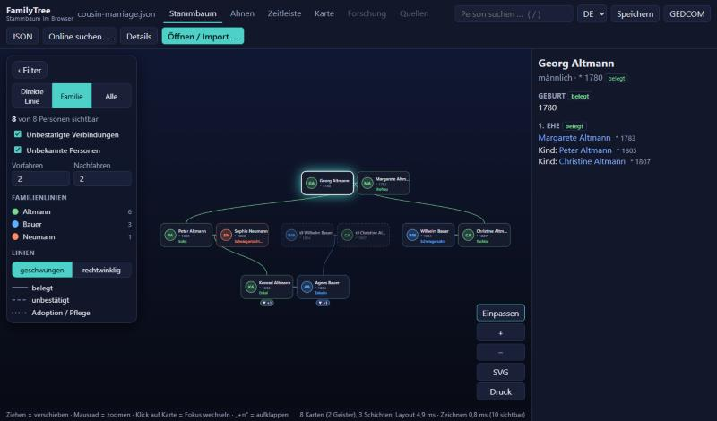
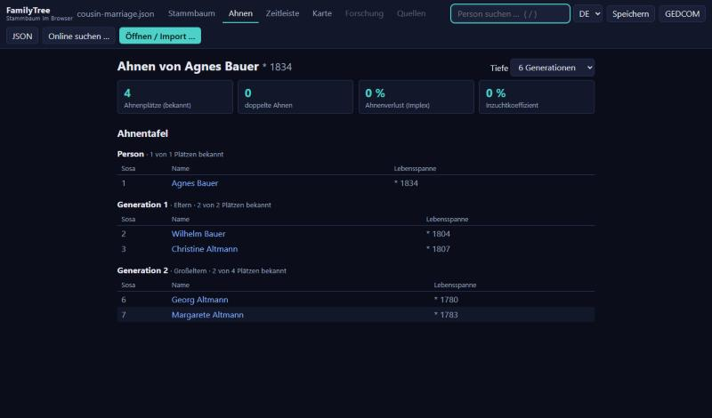
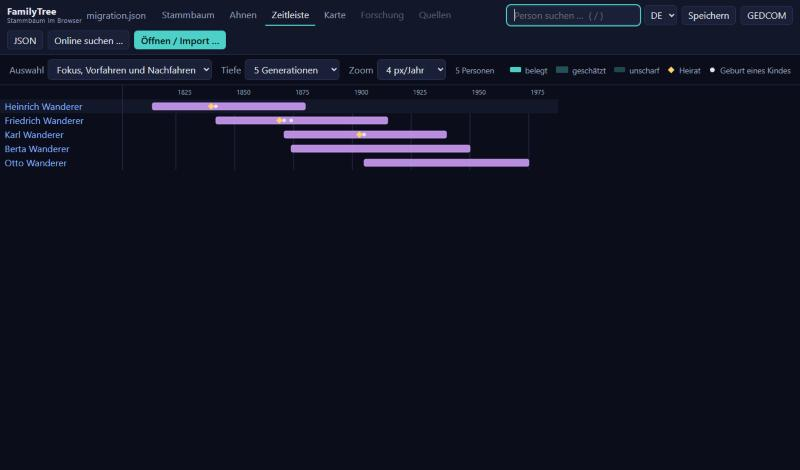
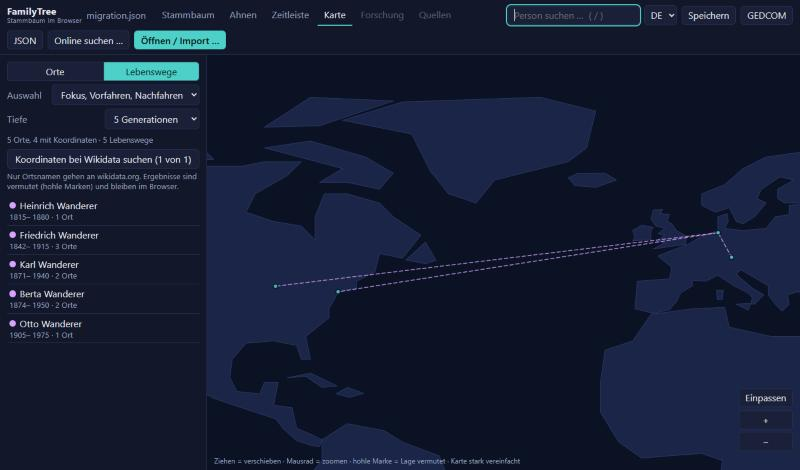

# FamilyTree

Browserbasierte Stammbaum-Software in TypeScript. Du wählst eine beliebige Person als **Fokus** und gehst von dort nach oben (Ahnen) und nach unten (Nachfahren). Daten werden tiefenabhängig geladen und gezeichnet, damit auch Bäume mit 50.000+ Personen flüssig bleiben. Alles läuft lokal im Browser (IndexedDB), es gibt keinen Server und keine Daten verlassen den Rechner, außer du löst bewusst eine Online-Suche aus.

## Funktionen

- **Stammbaum-Ansicht** (Canvas 2D): Sanduhr-Layout, Modi „Direkte Linie / Familie / Alle“, einstellbare Tiefe, Zoom und Verschieben, Kamerafahrt beim Fokuswechsel, Familienfarben, gestrichelte Linien für Unbestätigtes
- **Realistisches Datenmodell:** mehrere Ehen nacheinander, Halbgeschwister, Adoptiv- und Pflegekinder, Heirat unter Verwandten (Ahnenschwund, doppelte Ahnen werden verwiesen statt kopiert)
- **Unsichere Daten sind normal:** jede Aussage trägt Status (belegt / vermutet / unbekannt), unscharfe Daten („um 1750“) und Quellen
- **Ahnen-Reiter:** Ahnentafel mit Sosa-Nummern je Generation, Ahnenschwund und Implex, Inzuchtkoeffizient
- **Zeitleiste und Karte:** Lebensbalken mit unscharfen Daten; Orte und Lebenswege auf einer mitgelieferten Offline-Weltkarte, fehlende Koordinaten auf Knopfdruck bei Wikidata
- **Verwandtschaft:** „Was ist A für B?“, gemeinsame Vorfahren, Verwandtschaftsgrade
- **Import und Export:** GEDCOM (z. B. MyHeritage-Export) und JSON; Import im Web Worker
- **Online-Quellen:** Wikidata und WikiTree (offene APIs), FamilySearch als Gerüst; Treffer werden nur als „vermutet“ übernommen, Dubletten nur vorgeschlagen
- **Suche, Details, Speicher:** Namenssuche, Personendetails mit Quellen, Speichern mehrerer Bäume in IndexedDB

Stand und Fahrplan: [docs/PLAN.md](docs/PLAN.md). Geplant sind u. a. PDF/SVG-Export, Barrierefreiheit, Zweisprachigkeit und Backup.

## Schnellstart

Voraussetzung: [Node.js](https://nodejs.org/) 22 oder neuer.

```bash
npm install
npm run dev        # Entwicklungsserver (http://localhost:5173)
npm run build      # Produktionsbuild nach dist/
npm run typecheck  # TypeScript und Svelte prüfen
npm test           # Tests (Vitest)
```

Zum Ausprobieren im Browser über „Öffnen / Import …“ eine Datei aus `example/` laden (erfundene Personen). Einen großen Testbaum erzeugst du mit:

```bash
node scripts/generate-large-tree.mjs 50000
```

Hinweis: WikiTree erlaubt keine direkten Browser-Abfragen (kein CORS). Die Online-Suche dort funktioniert daher nur mit `npm run dev` (Vite-Proxy), siehe [DECISIONS.md](docs/DECISIONS.md) D25.

## Technik

TypeScript (strict) · Vite · Svelte 5 (nur Oberfläche) · Canvas 2D · Web Worker · IndexedDB (`idb`) · Vitest

Der Kern (`src/core`) ist reines TypeScript ohne DOM und Framework und läuft in Node und im Worker. Datenfluss: `import/providers → core → storage → render/ui`.

## Ordnerstruktur

| Ordner | Inhalt |
|---|---|
| `docs/` | alle Dokumente (Plan, Architektur, Entscheidungen, Changelog, Memory) |
| `example/` | erfundene Beispieldaten, nach Format getrennt (`gedcom`, `json`, `performance`) |
| `imports/` | **eigene** Dateien zum Importieren; Inhalt wird nicht in Git eingecheckt |
| `src/core` | Datenmodell, Graph, Suche, Verwandtschaft, Ahnentafel, Layout (ohne UI) |
| `src/import` | GEDCOM-Parser und -Export |
| `src/providers` | Online-Quellen (WikiTree, Wikidata, FamilySearch) |
| `src/render` | Zeichenfläche: Viewport, Culling, Szene |
| `src/ui` | Svelte-Oberfläche (Rahmen, Filter, Details, Dialoge, Ahnen) |
| `src/workers` | Web Worker für Import und Layout |
| `src/storage` | IndexedDB-Zugriff |
| `tests/` | Tests, gespiegelt zur `src`-Struktur |
| `scripts/` | Hilfsskripte (z. B. Testdaten generieren) |

## Datenschutz und Rechtliches

- Echte Familiendaten gehören nach `imports/` und werden nicht eingecheckt (`.gitignore`). In `example/` liegen nur erfundene Personen.
- Kein Scraping von MyHeritage, Ancestry oder anderen Diensten: nur Export-Dateien des Nutzers und offizielle bzw. offene APIs. Details in [DATA-SOURCES.md](docs/DATA-SOURCES.md).

## Dokumentation

Alle Dokumente liegen in [docs/](docs/README.md):
[PLAN](docs/PLAN.md) · [ARCHITECTURE](docs/ARCHITECTURE.md) · [DATA-MODEL](docs/DATA-MODEL.md) · [DATA-SOURCES](docs/DATA-SOURCES.md) · [DECISIONS](docs/DECISIONS.md) · [UI-KONZEPT](docs/UI-KONZEPT.md) · [TESTING](docs/TESTING.md) · [GLOSSARY](docs/GLOSSARY.md) · [CHANGELOG](docs/CHANGELOG.md) · [AGENTS](docs/AGENTS.md) (Regeln für Mitwirkende und KI-Assistenten)

## Bilder

Aufnahmen mit den erfundenen Beispieldaten aus `example/` (keine echten Personen).

**Stammbaum:** Fokusperson, Familienlinien, Filterpanel und Personendetails (`cousin-marriage.json`)



**Ahnen:** Ahnentafel mit Sosa-Nummern je Generation (`cousin-marriage.json`)



**Zeitleiste:** Lebensbalken auf einer Zeitachse mit Heirats- und Geburtsmarken (`migration.json`)



**Karte:** Orte und Lebenswege auf der mitgelieferten Offline-Weltkarte (`migration.json`)



## Lizenz

Das Projekt steht unter der **MIT-Lizenz** (siehe [LICENSE](LICENSE)). Welche Lizenzen die verwendeten Pakete und Datenquellen haben, steht in [LIZENZ.md](LIZENZ.md).
